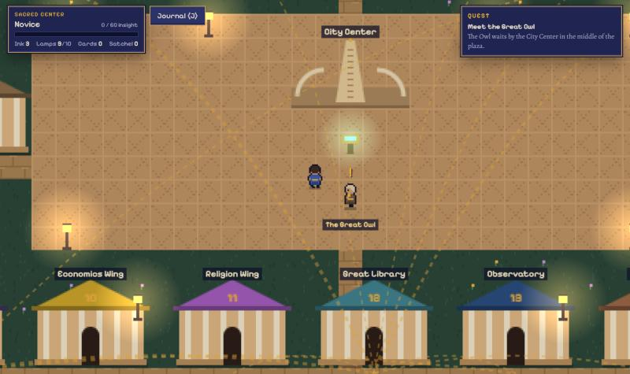
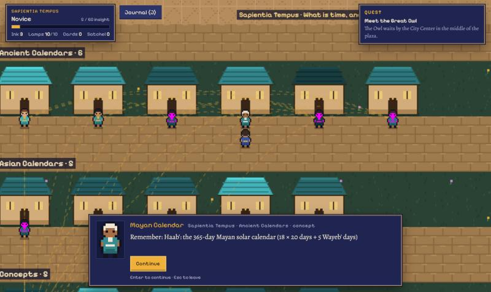

# The Arx

A pixel-art walk through **Sapientia Arx**, a personal knowledge city. Every note is a citizen, every link between notes is a golden thread, and every wing of the library is a district you can visit.

**Play it:** https://sapientia-ai.github.io/the-arx/

## What you do

- **Walk the districts.** Fourteen gates around the City Center open onto the knowledge wings, from Philosophy to Sapientia Tempus. Each holds the real notes of that wing, grouped by chamber.
- **Meet the citizens.** Each one tells you what their note says, then shows you its threads. Follow a thread to a related note, even in another district.
- **Restore the ruins.** Grey houses are notes that no link reaches yet. Propose a kin for one and scaffolding goes up.
- **Test yourself.** Each district's custodian quizzes you, and the Lawyer in the Court of Reason asks you to name the source of a line you have learned.
- **File a field report.** The Scribe gathers your proposed links and the notes worth rereading into a report for the library's Inbox.

**Controls:** WASD or arrow keys to move, E or Space to talk, J for the journal. On a phone, use the on-screen pad.

## About the content

The city holds 696 notes from fourteen knowledge wings. It shows each note's summary and key points, never the full text, and leaves out personal reflections.

Your progress is saved in your own browser only.

---

Part of [Sapientia](https://sapientia.org.in/).
